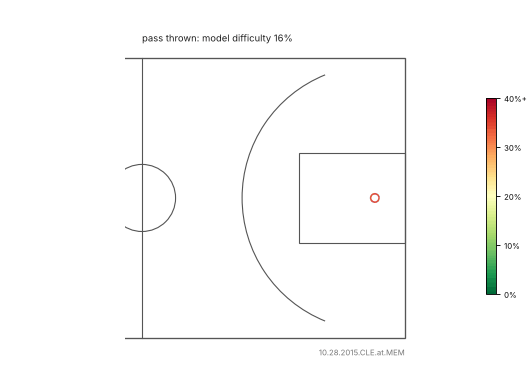

# basketballPlayOptimisation

Passing and shot quality from NBA SportVU player-tracking data (2015–16 season, 631 usable games).
The end goal is a reinforcement-learning agent that chooses plays; this repo builds the pieces it needs from real data:
**detect passes, and give every possible pass a calibrated difficulty (the probability it will not reach the intended teammate).**



*A real possession (10.28.2015 CLE @ MEM). Labels show the model's probability that each candidate pass is caught; line colour is
the difficulty (green = safe, red = likely to fail). The thick line is the pass actually thrown, with what happened to it.
Regenerate with `python difficulty/make_animation.py --out ../docs/pass_difficulty.gif` from `Code/`.*

## What is in here

| Part | What it does |
|---|---|
| `Code/passtracking.py` | Ball-holder state machine over every tracking frame: finds completed passes, matches play-by-play bad-pass turnovers to failed ones, and extracts release-time pass geometry. Resumable batch over all games. |
| `Code/difficulty/` | **Pass-difficulty model** for RL: `P(pass fails)` for any passer and teammate from one court state, plus a shot expected-points model and a small API. |
| `Code/pass_model.py`, `Code/evaluation.py` | Grouped-by-game evaluation (no game is ever in both train and test), calibration, bootstrap intervals. |
| `Code/value/` | Possession table from play-by-play and an expected-points state-value experiment (works end to end, not yet predictive; see its report). |
| `Shots/` | Shot detection and shot-quality features (Dhruv), spacing and velocity analysis. |
| `reports/` | Every experiment written up with numbers, confidence intervals and what did not work. |
| `Tracking_Data/` | Raw SportVU archives and play-by-play. |

## Pass difficulty in one minute

```python
# from Code/
from difficulty.api import PassValueModel

m = PassValueModel()
m.score_teammates(holder_xy, teammates_xy, defenders_xy, basket_xy, shot_clock)   # one row per teammate
#   p_complete          calibrated probability the pass reaches the intended teammate
#   difficulty          1 - p_complete
#   relative_difficulty log-odds of failure minus what the passer's situation alone predicts
```

Feet and ft/s on a 94 × 50 court; mirror-symmetric; all teammates are scored in one model pass (about 18 ms for four).

**How it was built.** Every live hold-end in a game is a release, and what happens to the ball next labels it (a teammate gets it,
or an opponent gets it / it goes out / it is fumbled). Features are measured at the release instant: pass length, the distance of each
defender to the pass line, the *interception margin* (how much earlier the ball reaches the line than the best-placed defender could),
receiver openness and speeds. A gradient-boosted model with isotonic calibration is trained and evaluated by game.

**How well it works** (100 held-out games, scored once; failures are 6.4% of passes):

| | ROC-AUC | PR-AUC | Brier skill |
|---|---|---|---|
| the passer's situation only | 0.744 | 0.262 | 0.100 |
| **full model** | **0.838** [0.828, 0.848] | **0.365** [0.337, 0.391] | **0.177** |

Predicted and observed failure rates agree in every decile, failure rate falls monotonically as defenders get closer to the pass line,
and a model that never saw an official bad-pass turnover as a failure still ranks them above completions at AUC 0.82.

## Read this before using it

- It predicts *a pass not reaching the intended teammate*, not "a turnover": about a third of its failures coincide with an official bad-pass turnover; the rest are deflections, loose balls and fumbles.
- The intended receiver is inferred from the first 0.3 s of ball flight (right for about 76% of completions).
- It was fit to 2015–16 defenders. A policy can find states outside that data. The API reports `in_distribution` for every pass, and an adversarial check (`reports/difficulty-exploit.md`) found one real weakness: with several defenders standing in the middle of the pass line the model still says about 74% complete. Mask out-of-distribution passes and do not let the policy place players.
- The shot-value layer (expected points) is weaker than the pass model and did not predict assists better than distance to the basket; use `p_complete` and let RL learn the continuation value.
- An earlier approach that used the turnover log as the label looked better (ROC 0.85) but was inflated by how the data were built; `reports/ws3-selection.md` shows how that was found.

## Setup

```bash
sudo apt-get install -y p7zip-full            # tracking archives are .7z
python3 -m venv .venv && .venv/bin/pip install pandas numpy scikit-learn scipy matplotlib tqdm tensorflow pytest
cd Code
../.venv/bin/python -m pytest -q .            # unit tests
../.venv/bin/python passtracking.py ../Shots/allgames.txt                       # per-game pass features (about 35 min serial)
../.venv/bin/python difficulty/extract.py <game list> --out <dir>               # difficulty dataset
../.venv/bin/python difficulty/train_eval.py --data <dir> --regime narrow --out ../reports/difficulty-dev-narrow
```

Games are split once and frozen: `Code/splits/dev_games.txt` (501), `test_games.txt` (130) and 100 dev games held out for the difficulty model
(`difficulty_final_games.txt`). Tune on dev only.

## Reports

`reports/ws2-eval.md` (evaluation), `reports/ws3-selection.md` (is the signal real?), `reports/ws4-detection.md` (dataset changes and the test run),
`reports/ws5b-value-review.md` (value model), `reports/difficulty-results.md` (the difficulty model), `reports/difficulty-exploit.md` (can a policy game it?).

## Credits

Passing pipeline and difficulty model: Yash Sangtani. Shooting pipeline: Dhruv.
