# Prototype possessions per discovered play (K=24)

Each GIF is a real possession from a validation game closest to the cluster centre (attack-normalised, offence red attacking the left basket, defence blue, ball orange, ring = ball handler, first 8 s after midcourt). These are clusters of formation, not verified plays (see `reports/rl-stage3.md`).

| play | val possessions | FG pts/poss | 3-pt share of shots | GIF |
|---|---|---|---|---|
| 0 | 664 | 0.82 | 28% | 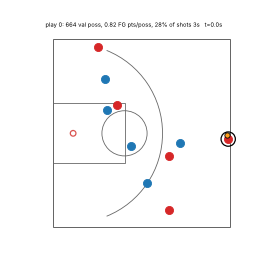 |
| 1 | 498 | 0.80 | 30% | 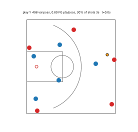 |
| 2 | 688 | 0.75 | 29% | 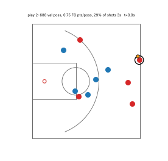 |
| 3 | 124 | 0.73 | 37% | 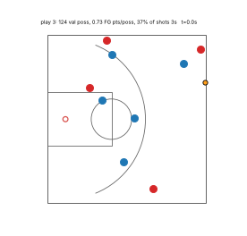 |
| 4 | 577 | 0.78 | 25% | 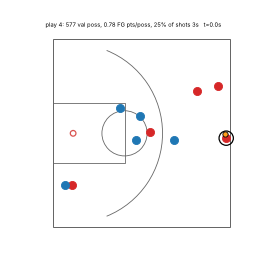 |
| 5 | 644 | 0.77 | 31% | 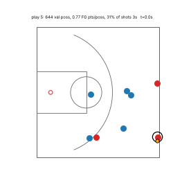 |
| 6 | 111 | 1.00 | 34% | 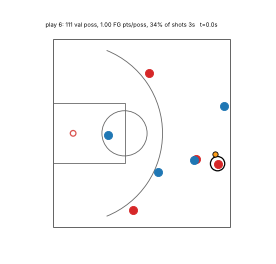 |
| 7 | 845 | 0.85 | 31% | 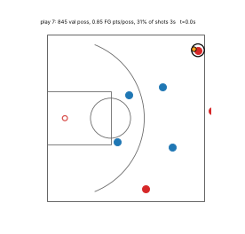 |
| 8 | 496 | 0.91 | 32% | 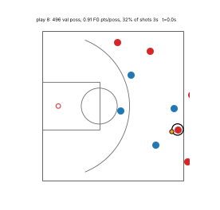 |
| 9 | 160 | 0.80 | 31% | 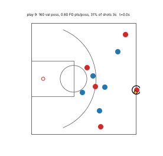 |
| 10 | 648 | 0.81 | 27% | 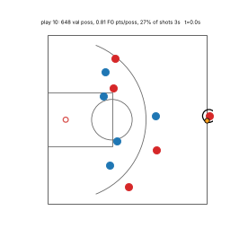 |
| 11 | 557 | 0.78 | 27% | 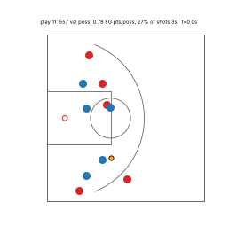 |
| 12 | 42 | 0.52 | 37% | 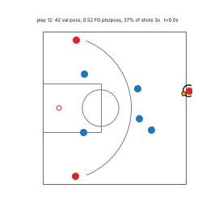 |
| 13 | 242 | 0.84 | 27% | 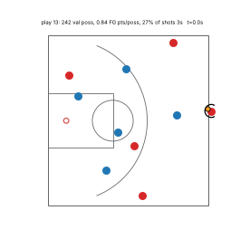 |
| 14 | 780 | 0.82 | 30% | 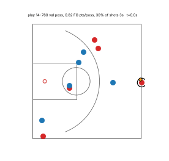 |
| 15 | 309 | 0.68 | 32% | 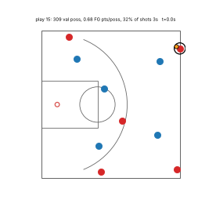 |
| 16 | 284 | 0.75 | 32% | 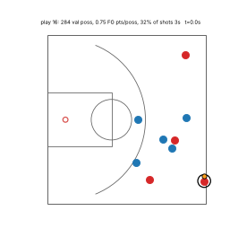 |
| 17 | 28 | 0.79 | 50% | 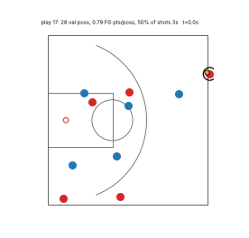 |
| 18 | 773 | 0.83 | 27% | 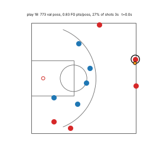 |
| 19 | 571 | 1.00 | 33% | 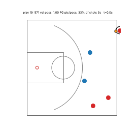 |
| 20 | 694 | 0.80 | 26% | 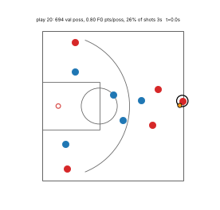 |
| 21 | 560 | 0.82 | 30% | 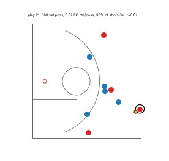 |
| 22 | 533 | 0.74 | 27% | 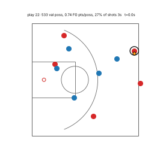 |
| 23 | 502 | 0.83 | 28% | 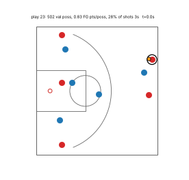 |
