# Run 2 checkpoints (every 10 iterations)

One GIF per checkpoint: a single simulated possession sampled from the policy at that iteration, preferring one that earned the play bonus (otherwise the longest of the batch). Stats are the mean over the 800 training possessions of the iteration *preceding* the GIF.

| iteration | reward (incl. bonus) | xPts part | play-bonus rate | clean-play rate | reached 6 s | shot share | passes | duration (s) | GIF |
|---|---|---|---|---|---|---|---|---|---|
| 10 | 0.960 | 0.951 | 0.037 | 0.070 | 0.216 | 0.901 | 1.41 | 2.77 | 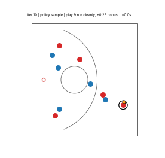 |
| 20 | 0.960 | 0.950 | 0.041 | 0.089 | 0.242 | 0.906 | 0.80 | 2.91 | 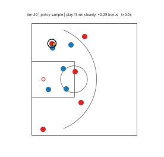 |
| 30 | 0.954 | 0.939 | 0.061 | 0.115 | 0.275 | 0.880 | 0.95 | 3.26 | 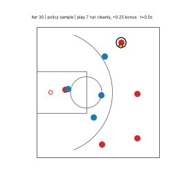 |
| 40 | 0.971 | 0.956 | 0.060 | 0.113 | 0.269 | 0.901 | 0.86 | 3.07 | 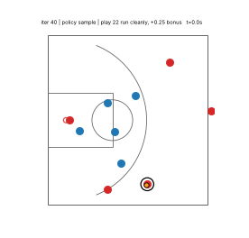 |
| 50 | 0.936 | 0.925 | 0.044 | 0.084 | 0.228 | 0.869 | 1.37 | 2.76 | 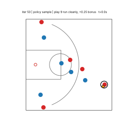 |
| 60 | 0.956 | 0.949 | 0.029 | 0.062 | 0.175 | 0.900 | 1.07 | 2.42 | 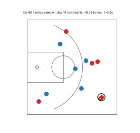 |
| 70 | 0.958 | 0.945 | 0.051 | 0.094 | 0.228 | 0.882 | 1.32 | 2.88 | 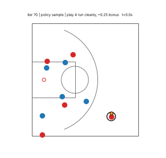 |
| 80 | 0.945 | 0.931 | 0.055 | 0.113 | 0.278 | 0.879 | 1.04 | 3.23 | 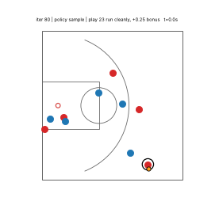 |
| 90 | 0.981 | 0.972 | 0.037 | 0.072 | 0.194 | 0.916 | 1.11 | 2.64 | 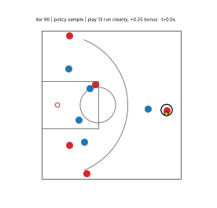 |
| 100 | 0.968 | 0.956 | 0.046 | 0.096 | 0.245 | 0.890 | 0.79 | 2.96 | 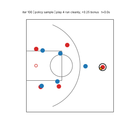 |
| 110 | 0.930 | 0.909 | 0.083 | 0.150 | 0.399 | 0.860 | 0.56 | 4.01 | 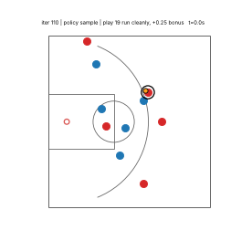 |
| 120 | 0.951 | 0.939 | 0.051 | 0.094 | 0.253 | 0.882 | 1.42 | 2.81 | 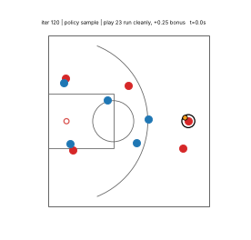 |
| 130 | 0.963 | 0.952 | 0.045 | 0.086 | 0.216 | 0.895 | 1.45 | 2.78 | 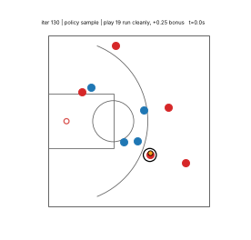 |
| 140 | 0.995 | 0.982 | 0.051 | 0.086 | 0.245 | 0.901 | 0.94 | 2.89 | 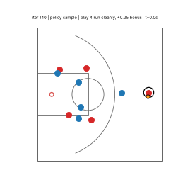 |
| 150 | 0.956 | 0.948 | 0.031 | 0.081 | 0.205 | 0.905 | 0.94 | 2.60 | 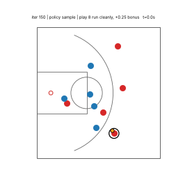 |
| 160 | 0.962 | 0.949 | 0.051 | 0.085 | 0.204 | 0.906 | 1.02 | 2.58 | 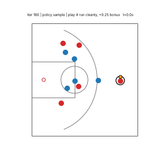 |
| 170 | 0.964 | 0.951 | 0.052 | 0.094 | 0.245 | 0.899 | 1.70 | 2.84 | 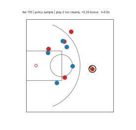 |
| 180 | 0.918 | 0.900 | 0.072 | 0.155 | 0.334 | 0.861 | 1.93 | 3.67 | 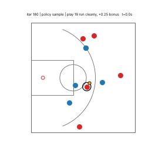 |
| 190 | 0.978 | 0.967 | 0.044 | 0.079 | 0.231 | 0.910 | 1.03 | 2.82 | 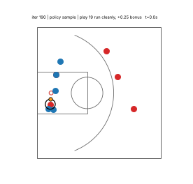 |
| 200 | 0.969 | 0.956 | 0.051 | 0.096 | 0.233 | 0.896 | 1.27 | 2.87 | 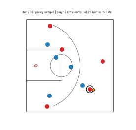 |
| 210 | 0.969 | 0.955 | 0.052 | 0.105 | 0.289 | 0.886 | 0.72 | 3.13 | 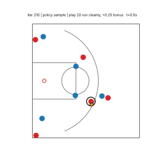 |
| 220 | 1.002 | 0.986 | 0.062 | 0.105 | 0.271 | 0.914 | 0.81 | 3.11 | 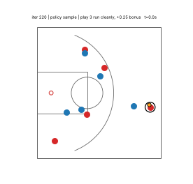 |
| 230 | 0.956 | 0.946 | 0.037 | 0.072 | 0.231 | 0.900 | 0.79 | 2.84 | 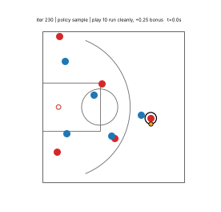 |
| 240 | 0.965 | 0.954 | 0.041 | 0.076 | 0.196 | 0.914 | 0.97 | 2.53 | 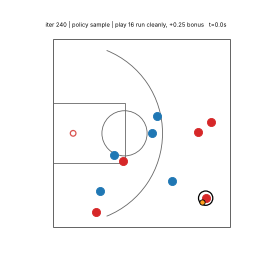 |
| 250 | 0.925 | 0.903 | 0.091 | 0.182 | 0.407 | 0.855 | 1.44 | 4.21 | 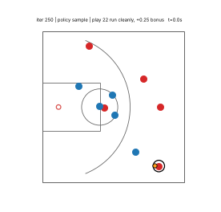 |
| 260 | 0.961 | 0.948 | 0.055 | 0.106 | 0.287 | 0.879 | 1.22 | 3.26 | 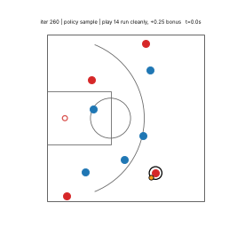 |
| 270 | 0.971 | 0.961 | 0.039 | 0.058 | 0.182 | 0.921 | 0.92 | 2.51 | 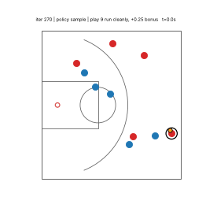 |
| 280 | 0.966 | 0.958 | 0.031 | 0.072 | 0.194 | 0.902 | 1.33 | 2.62 | 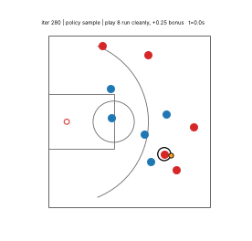 |
| 290 | 0.932 | 0.922 | 0.040 | 0.074 | 0.200 | 0.884 | 1.02 | 2.52 | 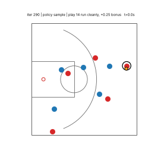 |
| 300 | 0.958 | 0.949 | 0.036 | 0.079 | 0.185 | 0.902 | 1.09 | 2.61 | 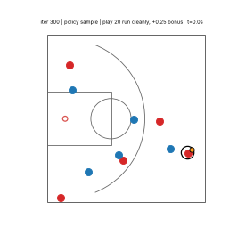 |
| 310 | 0.962 | 0.956 | 0.021 | 0.050 | 0.189 | 0.902 | 0.97 | 2.57 | 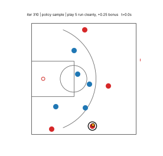 |
| 320 | 0.970 | 0.961 | 0.034 | 0.083 | 0.221 | 0.902 | 1.74 | 2.77 | 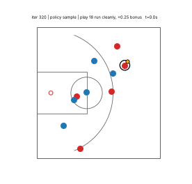 |
| 330 | 0.964 | 0.955 | 0.039 | 0.083 | 0.225 | 0.897 | 0.93 | 2.88 | 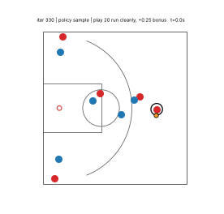 |
| 340 | 0.973 | 0.957 | 0.065 | 0.140 | 0.324 | 0.892 | 0.80 | 3.47 | 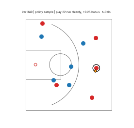 |
| 350 | 0.954 | 0.945 | 0.039 | 0.095 | 0.234 | 0.890 | 0.94 | 2.86 | 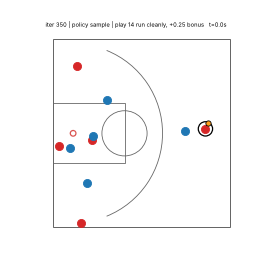 |
| 360 | 0.957 | 0.948 | 0.036 | 0.069 | 0.177 | 0.885 | 1.16 | 2.47 | 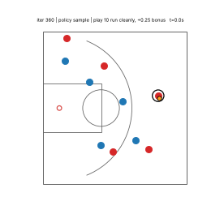 |
| 370 | 0.947 | 0.938 | 0.035 | 0.066 | 0.220 | 0.890 | 1.36 | 2.68 | 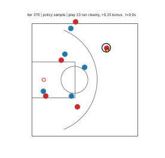 |
| 380 | 0.960 | 0.953 | 0.031 | 0.077 | 0.205 | 0.896 | 1.23 | 2.85 | 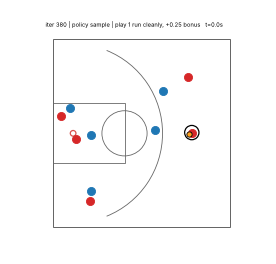 |
| 390 | 0.965 | 0.956 | 0.034 | 0.071 | 0.198 | 0.904 | 1.15 | 2.62 | 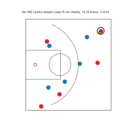 |
| 400 | 0.990 | 0.975 | 0.059 | 0.094 | 0.219 | 0.915 | 1.03 | 2.68 | 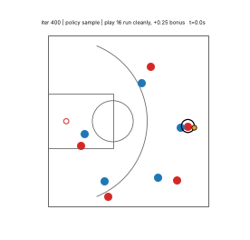 |
| 410 | 0.970 | 0.955 | 0.061 | 0.124 | 0.276 | 0.887 | 0.99 | 3.31 | 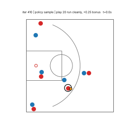 |
| 420 | 0.963 | 0.953 | 0.041 | 0.074 | 0.217 | 0.895 | 0.94 | 2.78 | 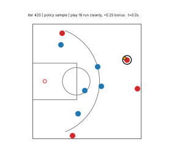 |
| 430 | 0.988 | 0.976 | 0.048 | 0.092 | 0.217 | 0.911 | 0.97 | 2.71 | 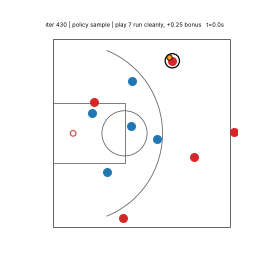 |
| 440 | 0.959 | 0.947 | 0.049 | 0.089 | 0.236 | 0.889 | 1.16 | 2.97 | 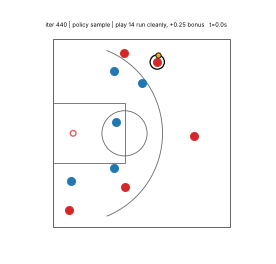 |
| 450 | 0.954 | 0.944 | 0.041 | 0.083 | 0.225 | 0.891 | 1.56 | 2.80 | 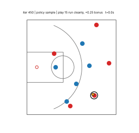 |
| 460 | 0.964 | 0.955 | 0.037 | 0.072 | 0.174 | 0.910 | 1.00 | 2.42 | 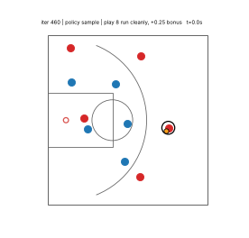 |
| 470 | 0.969 | 0.961 | 0.034 | 0.072 | 0.186 | 0.904 | 0.95 | 2.51 | 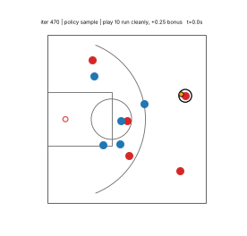 |
| 480 | 0.992 | 0.979 | 0.054 | 0.095 | 0.264 | 0.909 | 1.01 | 2.92 | 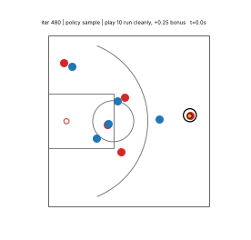 |
| 490 | 0.966 | 0.956 | 0.040 | 0.087 | 0.274 | 0.907 | 0.88 | 3.00 | 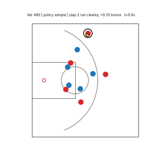 |
| 500 | 0.978 | 0.961 | 0.069 | 0.119 | 0.304 | 0.895 | 0.83 | 3.28 | 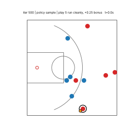 |
