# Stage 4c checkpoints (every 10 iterations)

One GIF per checkpoint: a simulated possession from the policy at that iteration with play-conditioned executors (red = offence, blue = defence, orange = ball, ring = ball handler); the title shows the chosen play and, when it applies, the clean formation and the bonus. Stats: mean over the 800 training possessions of the iteration before the GIF.

| iteration | reward (incl. bonus) | xPts part | play-bonus rate | followed chosen play | possessions reaching 3 s | shot share | passes | duration (s) | GIF |
|---|---|---|---|---|---|---|---|---|---|
| 10 | 0.986 | 0.954 | 0.129 | 0.337 | 0.635 | 0.897 | 0.94 | 2.81 | 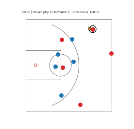 |
| 20 | 0.991 | 0.964 | 0.109 | 0.335 | 0.624 | 0.915 | 0.87 | 2.64 | 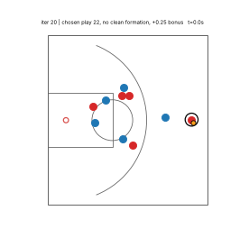 |
| 30 | 0.973 | 0.950 | 0.091 | 0.297 | 0.589 | 0.904 | 0.81 | 2.36 | 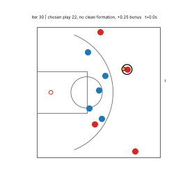 |
| 40 | 1.003 | 0.977 | 0.104 | 0.315 | 0.619 | 0.924 | 0.85 | 2.61 | 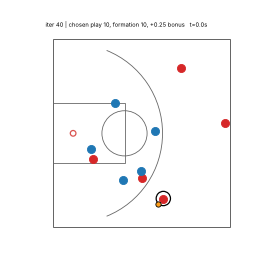 |
| 50 | 0.960 | 0.933 | 0.109 | 0.364 | 0.660 | 0.886 | 0.80 | 2.93 | 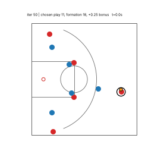 |
| 60 | 0.964 | 0.934 | 0.121 | 0.350 | 0.686 | 0.890 | 0.98 | 3.07 |  |
| 70 | 1.005 | 0.984 | 0.083 | 0.302 | 0.579 | 0.916 | 0.93 | 2.36 | 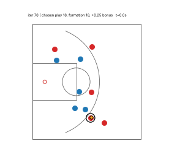 |
| 80 | 0.967 | 0.941 | 0.104 | 0.315 | 0.579 | 0.880 | 0.92 | 2.26 | 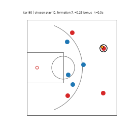 |
| 90 | 0.969 | 0.942 | 0.107 | 0.362 | 0.573 | 0.904 | 0.78 | 2.26 | 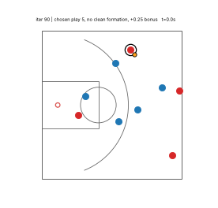 |
| 100 | 0.990 | 0.962 | 0.111 | 0.335 | 0.571 | 0.914 | 0.80 | 2.25 | 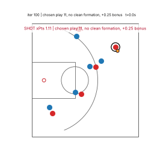 |
| 110 | 1.010 | 0.981 | 0.117 | 0.337 | 0.594 | 0.906 | 1.24 | 2.48 | 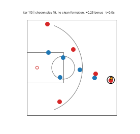 |
| 120 | 0.952 | 0.922 | 0.121 | 0.353 | 0.627 | 0.869 | 1.57 | 2.94 | 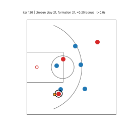 |
| 130 | 1.000 | 0.961 | 0.155 | 0.398 | 0.652 | 0.890 | 1.17 | 3.03 | 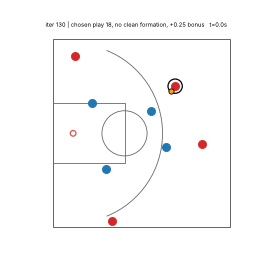 |
| 140 | 1.021 | 0.987 | 0.139 | 0.407 | 0.660 | 0.926 | 0.87 | 2.77 | 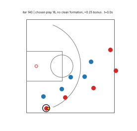 |
| 150 | 0.992 | 0.958 | 0.138 | 0.375 | 0.647 | 0.899 | 0.96 | 2.77 | 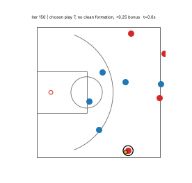 |
| 160 | 1.004 | 0.969 | 0.141 | 0.360 | 0.645 | 0.906 | 1.08 | 2.67 | 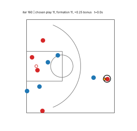 |
| 170 | 0.981 | 0.940 | 0.163 | 0.452 | 0.680 | 0.871 | 0.69 | 3.52 | 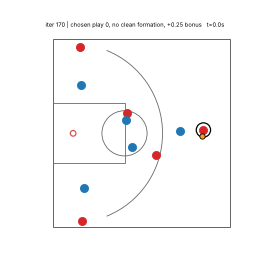 |
| 180 | 1.008 | 0.973 | 0.139 | 0.422 | 0.637 | 0.910 | 0.77 | 2.93 | 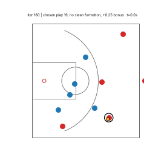 |
| 190 | 0.993 | 0.963 | 0.120 | 0.354 | 0.608 | 0.901 | 0.96 | 2.60 | 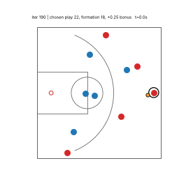 |
| 200 | 0.995 | 0.959 | 0.144 | 0.398 | 0.606 | 0.891 | 1.07 | 2.51 | 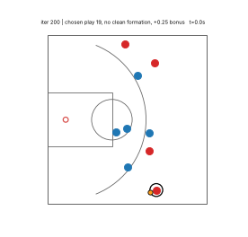 |
| 210 | 1.004 | 0.974 | 0.119 | 0.338 | 0.599 | 0.909 | 0.90 | 2.66 | 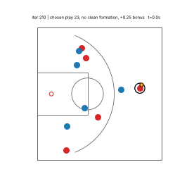 |
| 220 | 0.995 | 0.955 | 0.160 | 0.410 | 0.650 | 0.886 | 1.04 | 3.08 | 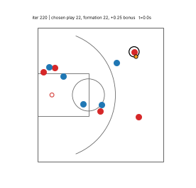 |
| 230 | 1.003 | 0.973 | 0.117 | 0.380 | 0.589 | 0.902 | 0.75 | 2.74 | 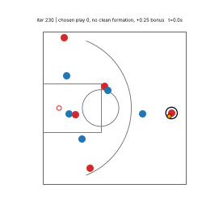 |
| 240 | 0.995 | 0.962 | 0.135 | 0.429 | 0.589 | 0.897 | 0.85 | 2.74 | 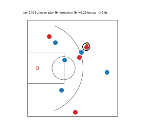 |
| 250 | 0.981 | 0.949 | 0.130 | 0.370 | 0.581 | 0.887 | 1.34 | 2.52 | 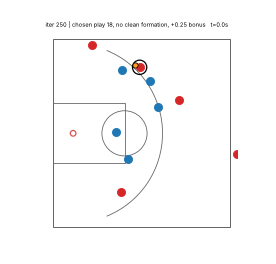 |
| 260 | 0.985 | 0.960 | 0.104 | 0.364 | 0.594 | 0.896 | 0.60 | 2.83 | 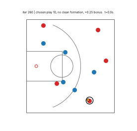 |
| 270 | 0.985 | 0.954 | 0.126 | 0.421 | 0.606 | 0.891 | 0.69 | 2.86 | 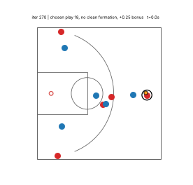 |
| 280 | 1.016 | 0.984 | 0.128 | 0.381 | 0.588 | 0.925 | 0.82 | 2.50 | 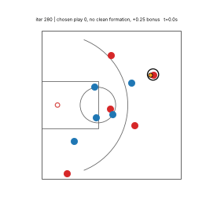 |
| 290 | 1.006 | 0.974 | 0.126 | 0.389 | 0.571 | 0.905 | 0.77 | 2.40 | 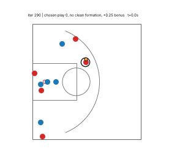 |
| 300 | 0.965 | 0.940 | 0.099 | 0.365 | 0.559 | 0.896 | 0.78 | 2.32 | 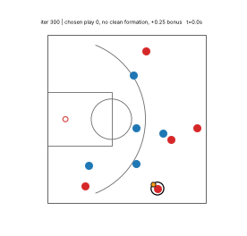 |
| 310 | 1.026 | 0.996 | 0.120 | 0.370 | 0.564 | 0.907 | 0.77 | 2.58 | 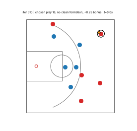 |
| 320 | 1.012 | 0.977 | 0.141 | 0.407 | 0.614 | 0.909 | 0.99 | 2.82 | 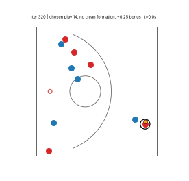 |
| 330 | 1.008 | 0.977 | 0.124 | 0.394 | 0.580 | 0.904 | 1.04 | 2.53 | 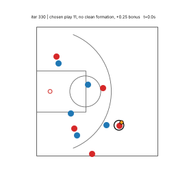 |
| 340 | 1.013 | 0.973 | 0.156 | 0.422 | 0.646 | 0.906 | 1.01 | 2.89 | 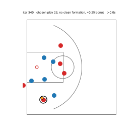 |
| 350 | 1.019 | 0.990 | 0.115 | 0.387 | 0.598 | 0.924 | 0.82 | 2.67 | 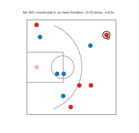 |
| 360 | 1.014 | 0.982 | 0.125 | 0.361 | 0.564 | 0.907 | 0.89 | 2.37 | 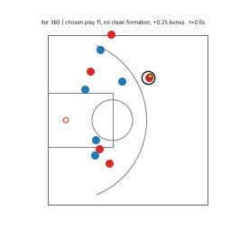 |
| 370 | 1.010 | 0.980 | 0.120 | 0.374 | 0.588 | 0.902 | 0.76 | 2.69 | 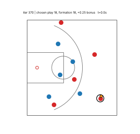 |
| 380 | 0.996 | 0.967 | 0.117 | 0.398 | 0.588 | 0.902 | 0.75 | 2.61 | 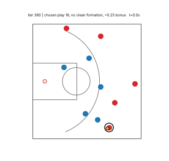 |
| 390 | 1.002 | 0.962 | 0.163 | 0.477 | 0.647 | 0.897 | 0.64 | 3.34 | 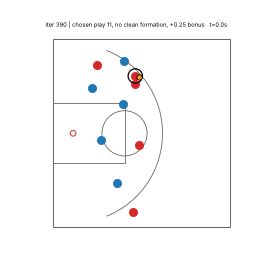 |
| 400 | 1.004 | 0.973 | 0.126 | 0.360 | 0.570 | 0.909 | 0.89 | 2.46 | 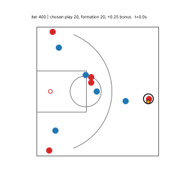 |
| 410 | 1.001 | 0.968 | 0.131 | 0.427 | 0.613 | 0.892 | 0.70 | 2.92 | 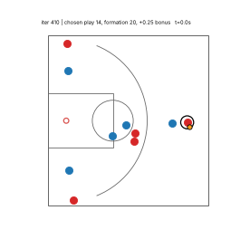 |
| 420 | 0.993 | 0.963 | 0.119 | 0.444 | 0.608 | 0.899 | 0.67 | 3.05 | 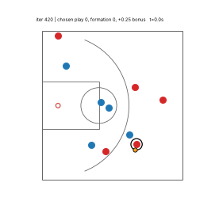 |
| 430 | 1.007 | 0.976 | 0.128 | 0.390 | 0.635 | 0.895 | 0.66 | 3.05 | 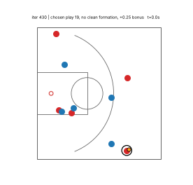 |
| 440 | 1.006 | 0.967 | 0.154 | 0.419 | 0.647 | 0.899 | 0.72 | 2.92 | 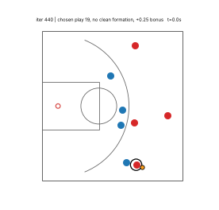 |
| 450 | 0.988 | 0.958 | 0.120 | 0.378 | 0.621 | 0.886 | 0.76 | 3.01 | 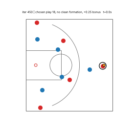 |
| 460 | 0.997 | 0.967 | 0.120 | 0.370 | 0.578 | 0.897 | 0.70 | 2.59 | 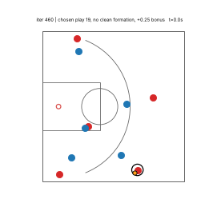 |
| 470 | 1.027 | 0.996 | 0.125 | 0.389 | 0.581 | 0.916 | 1.03 | 2.63 | 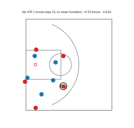 |
| 480 | 1.010 | 0.981 | 0.117 | 0.351 | 0.599 | 0.911 | 1.27 | 2.62 | 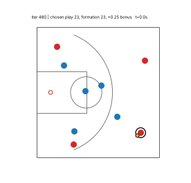 |
| 490 | 0.994 | 0.963 | 0.128 | 0.407 | 0.580 | 0.891 | 0.68 | 2.81 | 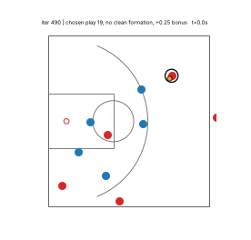 |
| 500 | 1.032 | 1.001 | 0.121 | 0.403 | 0.559 | 0.932 | 0.80 | 2.47 | 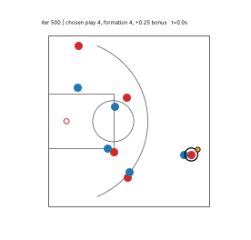 |
